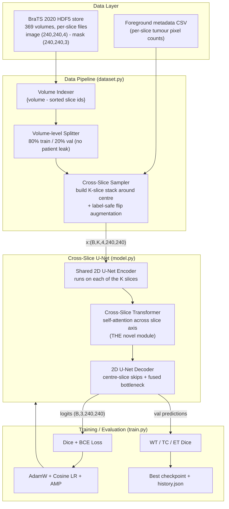
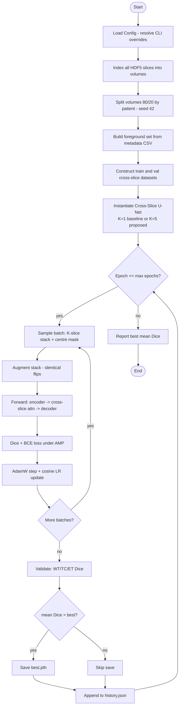

# Design and Solution

**Project:** Context-Aware Cross-Slice Transformer for Glioma Segmentation on BraTS 2020
**Modality:** Multi-modal brain MRI (T1, T1ce, T2, FLAIR)

This section describes the design of the proposed system exactly as it is
implemented in the `glioma_seg/cst/` package. Every module, diagram, and
algorithm below corresponds to real code (`config.py`, `dataset.py`,
`model.py`, `losses.py`, `metrics.py`, `train.py`), and the numbers quoted
(parameter counts, tensor shapes, hyper-parameters) were measured on the
actual implementation rather than assumed.

---

## 1. System Architecture

### 1.1 Design rationale

A glioma is a 3-D object, but a full 3-D CNN over four MRI modalities does not
fit in the 4 GB of VRAM available on the target machine. A purely 2-D model
fits comfortably but throws away the anatomical continuity between adjacent
slices, which is exactly the information a radiologist uses to keep a tumour
boundary consistent from one slice to the next.

The proposed system takes a **2.5-D** middle path: it processes a small stack
of *K* consecutive axial slices, but injects cross-slice context only at the
network bottleneck through a lightweight **Cross-Slice Transformer**. This is
the novelty of the project — the adaptive slice-fusion attention idea is
adapted from the 2026 Cross-Slice Transformer paper (originally CT lymph
nodes) and re-purposed for multi-modal brain MRI. A single configuration flag
(`n_slices`) collapses the whole system to a plain 2-D U-Net, giving a clean
one-variable ablation.

### 1.2 High-level architecture block diagram



**Data flow in one line:** HDF5 slices → volume index → volume-level split →
K-slice stack → shared encoder → cross-slice attention → decoder → 3-channel
mask → Dice/BCE loss (train) or WT/TC/ET Dice (eval) → best checkpoint.

### 1.3 Internal data-flow through the network

```
 x : (B, K, 4, 240, 240)          K adjacent slices, 4 MRI modalities
        │  reshape (B·K, 4, 240, 240)     -- treat every slice independently
        ▼
 Shared 2D U-Net Encoder
   e1 → 48ch  @240²   ─┐ (skip s1)
   e2 → 96ch  @120²   ─┤ (skip s2)   only the CENTRE slice's skips are kept
   e3 → 192ch @ 60²   ─┘ (skip s3)
   e4 → 384ch @ 30²   ── bottleneck  b : (B·K, 384, 30, 30)
        │  reshape (B, K, 384, 30, 30)
        ▼
 Cross-Slice Transformer  (only when K>1)
   tokens : (B·30·30, K, 384)      K tokens per spatial location
   + learnable slice-position embedding
   TransformerEncoder (2 layers, 4 heads)   → attend across the K slices
   take centre token                → fused b : (B, 384, 30, 30)
        │
        ▼
 2D U-Net Decoder  (uses centre-slice skips s1,s2,s3)
   up3+s3 → 192ch → up2+s2 → 96ch → up1+s1 → 48ch
        │
        ▼
 1×1 Conv head → logits : (B, 3, 240, 240)   [NCR/NET, ED, ET]
```

---

## 2. Module Description

The system is decomposed into seven cooperating modules. For each we give its
**purpose, inputs, outputs, and functionality**.

### 2.1 Configuration Module (`config.py`)
- **Purpose:** Single source of truth for every tunable parameter, so the
  proposed model and the baseline differ by exactly one flag.
- **Inputs:** None at runtime (a dataclass); optional CLI overrides.
- **Outputs:** A `Config` object read by every other module.
- **Functionality:** Holds data paths, image size (240), modality count (4),
  class count (3), the cross-slice knob `n_slices` (1 = baseline, 5 =
  proposed), model width `base_ch=48`, transformer heads/layers (4/2), and
  training hyper-parameters (batch 4, 80 epochs, lr 2e-4, AdamW weight decay
  1e-5, val fraction 0.2, seed 42, AMP on). A `half` property derives the
  neighbour radius `K//2`.

### 2.2 Data Indexing & Splitting Module (`dataset.py` — helpers)
- **Purpose:** Organise ~24k loose per-slice HDF5 files into per-patient
  volumes and produce a leak-free train/validation split.
- **Inputs:** The data directory of `volume_{V}_slice_{S}.h5` files; optionally
  `BraTS20 Training Metadata.csv`.
- **Outputs:** `index = {volume_id → sorted slice indices}`; two disjoint
  volume sets; a set of `(volume, slice)` pairs that contain tumour.
- **Functionality:**
  - `build_volume_index` scans filenames with a regex and groups slices by
    volume.
  - `split_volumes` shuffles **volumes** (not slices) with a fixed seed and
    holds out 20 % — guaranteeing that no patient appears in both splits.
  - `build_foreground_set` reads per-slice label pixel-counts from the CSV to
    instantly identify tumour-bearing slices, avoiding opening every file.

### 2.3 Cross-Slice Dataset Module (`BraTSCrossSlice`)
- **Purpose:** Turn a target centre slice into a spatially-consistent stack of
  its neighbours plus the centre-slice mask.
- **Inputs:** A `(volume, centre_slice)` sample index.
- **Outputs:** `x : (K, 4, 240, 240)` slice stack, `y : (3, 240, 240)` centre
  mask (torch float tensors).
- **Functionality:** For offsets `-K//2 … +K//2` it loads each neighbour,
  **clamping to the volume's first/last slice** at the edges so stacks are
  always full. It selects foreground-only centres (tumour present). During
  training it applies **label-safe horizontal/vertical flips applied
  identically to all K slices and the mask**, preserving geometric
  correspondence across the stack. Images are already z-score normalised in the
  dataset, so no extra intensity scaling is needed.

### 2.4 Encoder Module (`Encoder` in `model.py`)
- **Purpose:** Extract multi-scale features from a single slice; shared weights
  across all K slices.
- **Inputs:** `(B·K, 4, 240, 240)`.
- **Outputs:** Bottleneck `b : (B·K, 384, 30, 30)` and three skip tensors
  (48 @240², 96 @120², 192 @60²).
- **Functionality:** Four double-conv blocks (Conv-BN-ReLU ×2) with 2×2 max-
  pooling between them, widths 48→96→192→384. Weight sharing keeps the model
  small (the encoder cost does not grow with K) and ensures every slice is
  embedded in the same feature space before fusion.

### 2.5 Cross-Slice Transformer Module (`CrossSliceTransformer`) — **novel**
- **Purpose:** Fuse anatomical context from neighbouring slices into the centre
  slice at the bottleneck.
- **Inputs:** `(B, K, 384, 30, 30)` bottleneck features from all K slices.
- **Outputs:** Fused centre features `(B, 384, 30, 30)`.
- **Functionality:** At each of the 30×30 spatial positions it forms a length-K
  token sequence (one token per slice, feature dim 384), adds a **learnable
  slice-position embedding**, and applies a 2-layer, 4-head
  `TransformerEncoder` (feed-forward dim 768, dropout 0.1) that performs
  **self-attention along the slice axis**. It then reads out the centre token
  as the context-enriched bottleneck. When `n_slices=1` this module is skipped
  entirely, so the network degrades gracefully to a 2-D U-Net.

### 2.6 Decoder Module (`Decoder`)
- **Purpose:** Reconstruct the full-resolution segmentation of the centre
  slice.
- **Inputs:** Fused bottleneck `(B, 384, 30, 30)` and the **centre slice's**
  skip connections.
- **Outputs:** Logits `(B, 3, 240, 240)` for channels [NCR/NET, ED, ET].
- **Functionality:** Three transpose-conv up-sampling stages, each concatenating
  the matching-resolution centre-slice skip and refining with a double-conv
  block (384→192→96→48), followed by a 1×1 convolution to the 3 class channels.
  Using only the centre slice's skips keeps high-resolution detail aligned to
  the slice actually being predicted, while the cross-slice context enters
  through the bottleneck.

### 2.7 Loss & Metrics Modules (`losses.py`, `metrics.py`)
- **Purpose:** Optimise overlap and report clinically standard scores.
- **Inputs:** Logits `(B, 3, 240, 240)` and target mask.
- **Outputs:** A scalar training loss; a `{WT, TC, ET, mean}` Dice dictionary.
- **Functionality:**
  - `DiceBCELoss` = 0.5·(1 − soft Dice) + 0.5·BCE, computed per class channel
    after a sigmoid (channels are non-exclusive, so sigmoid — not softmax).
  - `metrics.to_regions` converts the 3 raw channels into the three nested
    BraTS evaluation regions — **WT** = NCR/NET∪ED∪ET, **TC** = NCR/NET∪ET,
    **ET** = ET — and `dice_score` reports per-region Dice plus their mean.

### 2.8 Training Orchestrator (`train.py`)
- **Purpose:** Wire the modules together, run the experiment, and persist the
  best model.
- **Inputs:** CLI flags (`--exp`, `--n_slices`, `--epochs`, `--batch_size`,
  `--limit_vols`).
- **Outputs:** `runs/<exp>/best.pth` and `runs/<exp>/history.json`.
- **Functionality:** Builds loaders, instantiates the model, trains with
  AdamW + cosine-annealed LR under automatic mixed precision, evaluates every
  epoch, checkpoints on best **mean Dice**, and logs per-epoch history.

---

## 3. Workflow

### 3.1 End-to-end process flow



### 3.2 Stage-by-stage explanation

1. **Configuration** — parameters are loaded; a CLI flag chooses baseline
   (K=1) or proposed (K=5). Everything else is held constant so the ablation is
   fair.
2. **Indexing** — all per-slice files are grouped into their parent volumes.
3. **Splitting** — volumes are partitioned 80/20 with a fixed seed; splitting
   at the *patient* level prevents optimistic leakage from adjacent slices of
   the same patient appearing in both sets.
4. **Foreground selection** — the metadata CSV is used to keep only
   tumour-bearing centre slices, which focuses learning and speeds up epochs.
5. **Batch construction** — for each centre slice a stack of K neighbours is
   assembled (edge-clamped) and given identical random flips.
6. **Forward pass** — the shared encoder embeds every slice, the Cross-Slice
   Transformer fuses neighbour context at the bottleneck, and the decoder
   predicts the centre-slice mask.
7. **Optimisation** — Dice+BCE loss is minimised with AdamW under mixed
   precision; the learning rate follows a cosine schedule.
8. **Validation & checkpointing** — after each epoch the model is scored on the
   held-out volumes; the checkpoint with the best mean Dice is retained.
9. **Reporting** — per-epoch metrics are written to `history.json`; comparing
   `xslice_k5` vs `baseline_k1` mean Dice quantifies the cross-slice
   contribution.

---

## 4. Algorithm(s)

### 4.1 Cross-slice stack construction

```
Input : volume V, centre slice c, radius h = K // 2,
        sorted present slices S(V)
Output: stack x (K,4,240,240), mask y (3,240,240)

for off in [-h .. +h]:
    s ← clamp(c + off, min S(V), max S(V))   # repeat edge slices
    img, msk ← read_h5(volume_V_slice_s)      # (240,240,4),(240,240,3)
    append img to stack
    if off == 0: y ← msk
x ← stack reshaped to (K,4,240,240)
y ← y reshaped to (3,240,240)
if training: x, y ← same_random_flips(x, y)
return x, y
```

### 4.2 Forward pass of the Cross-Slice U-Net

```
Input : x (B,K,4,240,240)
Output: logits (B,3,240,240)

flat        ← reshape x to (B*K, 4, 240, 240)
b, skips    ← Encoder(flat)                 # b:(B*K,384,30,30)

if K > 1:                                   # proposed model
    b       ← reshape b to (B,K,384,30,30)
    b       ← CrossSliceTransformer(b)      # fuse -> (B,384,30,30)
    skips   ← keep centre-slice skips only  # index K//2 of each skip
else:                                        # baseline (K==1)
    b, skips already correspond to centre

logits      ← Decoder(b, skips)
return logits
```

### 4.3 Cross-Slice Transformer (the novel fusion)

```
Input : feats (B,K,C,h,w)          C=384, h=w=30
Output: fused (B,C,h,w)

tokens ← permute+reshape feats to (B*h*w, K, C)   # K tokens / position
tokens ← tokens + slice_position_embedding
tokens ← TransformerEncoder(tokens)               # attend across slice axis
grid   ← reshape tokens to (B,h,w,K,C)
centre ← grid[:, :, :, K//2, :]                   # read out centre slice
fused  ← permute centre to (B,C,h,w)
return fused
```

### 4.4 Training / evaluation loop

```
build index, split volumes, build datasets & loaders
model ← CrossSliceUNet(cfg);  opt ← AdamW;  sched ← CosineAnnealingLR
best ← -1

for epoch in 1..E:
    # --- train ---
    for (x,y) in train_loader:
        with autocast(AMP):
            logits ← model(x)
            loss   ← 0.5*(1 - softDice(logits,y)) + 0.5*BCE(logits,y)
        scaler.scale(loss).backward();  scaler.step(opt);  scaler.update()
    sched.step()

    # --- validate ---
    for (x,y) in val_loader:
        pred ← (sigmoid(model(x)) > 0.5)
        accumulate Dice over regions {WT,TC,ET}
    mean ← average(WT,TC,ET)

    if mean > best:
        best ← mean;  save best.pth
    append metrics to history.json

report best
```

### 4.5 Region Dice metric

```
Input : predicted binary (B,3,H,W), target binary (B,3,H,W)
regions: WT = NCR/NET | ED | ET
         TC = NCR/NET | ET
         ET = ET
for region r:
    inter ← sum(pred_r * tgt_r);  denom ← sum(pred_r)+sum(tgt_r)
    Dice_r ← (2*inter + eps) / (denom + eps), averaged over batch
mean ← (Dice_WT + Dice_TC + Dice_ET) / 3
```

### 4.6 Ablation protocol

The experiment is a single controlled variable. Two runs are trained under
**identical** data splits, seeds, and hyper-parameters:

| Run          | `n_slices` | Cross-Slice Transformer | Parameters |
|--------------|-----------:|-------------------------|-----------:|
| `baseline_k1`| 1          | disabled (2-D U-Net)    | 4.33 M     |
| `xslice_k5`  | 5          | enabled (proposed)      | 6.70 M     |

The difference in mean Dice between the two runs isolates the contribution of
cross-slice attention.

---

## 5. Technology Stack

| Layer | Technology | Role in the project |
|-------|-----------|---------------------|
| Language | **Python 3.13** | Entire implementation |
| Deep-learning framework | **PyTorch 2.7 (CUDA 12.6 build)** | Model, training loop, autograd |
| Neural modules | `torch.nn` — Conv2d, BatchNorm2d, ConvTranspose2d, **TransformerEncoder / TransformerEncoderLayer** | U-Net + cross-slice attention |
| Mixed precision | `torch.cuda.amp` (autocast + GradScaler) | Fits training into 4 GB VRAM |
| Optimisation | AdamW + `CosineAnnealingLR` | Weight update & LR schedule |
| Data format | **HDF5** via **h5py 3.16** | Per-slice MRI volumes |
| Numerics | **NumPy 2.2** | Slice stacking, transposes, RNG splits |
| Metadata | **CSV** (`csv` module) | Fast foreground-slice lookup |
| Data loading | `torch.utils.data.Dataset` / `DataLoader` (multi-worker, pinned memory) | Cross-slice sampling pipeline |
| Config | `dataclasses` | Central hyper-parameter object |
| Persistence | `torch.save` (`.pth`) + **JSON** (`history.json`) | Checkpoints & training logs |
| CLI | `argparse` | Experiment selection / overrides |
| Diagrams / docs | **Markdown + Mermaid** | This report |
| Version control | **Git** | Source management |

**Dataset:** BraTS 2020 training set — 369 multi-modal MRI volumes (T1, T1ce,
T2, FLAIR), stored as ~24k per-slice HDF5 files (image `240×240×4`, one-hot
mask `240×240×3`). No external database or web API is used; all data is local.

---

## 6. Hardware and Software Requirements

### 6.1 Hardware (development / target machine)

| Component | Specification used | Minimum recommended |
|-----------|--------------------|---------------------|
| GPU | **NVIDIA GeForce RTX 3050 Laptop, 4 GB GDDR6** | CUDA GPU with ≥ 4 GB VRAM |
| CPU | **12th-Gen Intel Core i5-12500H** (12-core) | Quad-core x86-64 |
| RAM | **16 GB** | ≥ 8 GB |
| Storage | Local SSD, ~15 GB free for the HDF5 dataset + checkpoints | ≥ 20 GB free |

The 4 GB VRAM ceiling is the single most important hardware constraint and is
the reason the design is 2.5-D with mixed precision rather than full 3-D.
At `base_ch=48`, `batch_size=4`, K=5 the model trains within this budget.

### 6.2 Software environment

| Item | Version / detail |
|------|------------------|
| Operating system | Linux (Fedora 42, kernel 6.19, 64-bit) |
| Python | 3.13.13 |
| PyTorch | 2.7.0 (`+cu126` build) |
| CUDA runtime / driver | CUDA 12.6 / NVIDIA driver 580.x |
| h5py | 3.16.0 |
| NumPy | 2.2.6 |
| IDE / tooling | VS Code; Git for version control |
| Dependencies | Standard library only beyond the above (`argparse`, `csv`, `json`, `os`, `re`, `glob`, `dataclasses`) |

### 6.3 Reproduction commands

```bash
cd glioma_seg

# Proposed model (cross-slice, K=5)
python -m cst.train --exp xslice_k5  --n_slices 5

# Baseline for the ablation (plain 2-D U-Net, K=1)
python -m cst.train --exp baseline_k1 --n_slices 1

# Fast sanity check (few volumes, 1 epoch)
python -m cst.train --exp smoke --n_slices 5 --epochs 1 --limit_vols 6
```

Outputs are written to `runs/<exp>/best.pth` and `runs/<exp>/history.json`;
the mean-Dice gap between `xslice_k5` and `baseline_k1` is the headline result.
